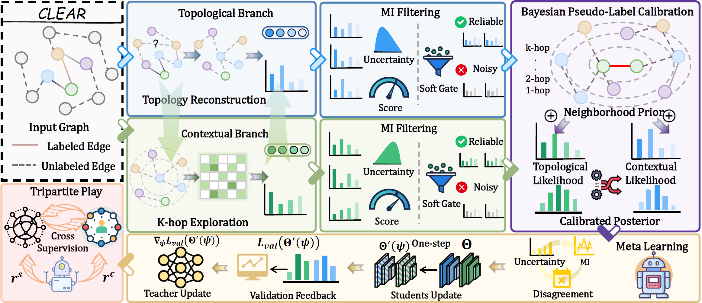

# CLEAR

## Environment Requirements

- Python 3.10+ (current local environment: Python 3.12.7)
- PyTorch
- PyTorch Geometric
- sentence-transformers
- NumPy
- pandas
- scikit-learn
- requests
- CUDA-enabled GPU is recommended, but the code can also run on CPU

## Overview

## Abstract

This paper studies the problem of semi-supervised edge classification, which aims to identify edge relations using both labeled and unlabeled data. This problem is highly challenging due to the inherent asymmetry of edge relations and strong prediction biases from imbalanced homophilous and heterophilous edges. Towards this end, this paper proposes a novel approach named \underline{C}omp\underline{l}ementary Tripartit\underline{e} Play with B\underline{a}yesian Calib\underline{r}ation (CLEAR) for semi-supervised edge classification. The core of our CLEAR is to incorporate asymmetric semantic branches and a meta-teacher into a tripartite-play framework, enabling reliable guidance and optimization under label scarcity. In particular, our CLEAR introduces a topological branch and a contextual branch which extracts graph semantics, generating pseudo-labeling in complementary views. To improve the reliability of pseudo-labels, we filter low-quality pseudo-labels using epistemic uncertainty, and then calibrate posterior distributions using the prior from neighborhood-informed priors. More importantly, we utilize a meta-consoler to guide the optimization of two branches by outputting the objective coefficients, ensuring a reliable pseudo-labeling process in a tripartite play framework. Extensive experiments on benchmark frameworks validates the superiority of the proposed CLEAR in comparison to various baselines.

